# Animaux V2 — modèles 3D low poly pour Roblox

Modèles générés par scripts Python avec Blender en headless (module `bpy`, sans interface).

## Installation

```bash
pip install -r requirements.txt   # installe bpy (Blender 5.2 en module Python)
```

## Générer un modèle

```bash
python3 scripts/gardien_belier.py                    # export + images d'aperçu
python3 scripts/gardien_rat.py --no-render           # export seulement (plus rapide)
python3 scripts/animations_belier.py                 # squelette + animations (+ GIF d'aperçu)
python3 scripts/animations_rat.py
python3 scripts/verifier_animations.py animations_rat  # vérifie pieds / sol de chaque animation
```

La méthode complète (outils, règles de qualité, animations, import Roblox) est rangée dans le skill
`.claude/skills/modele-roblox-lowpoly/` : Claude Code le charge automatiquement pour les prochains modèles.

Sorties :
- `exports/<Nom>/<Nom>.fbx` et `.glb` : à importer dans Roblox Studio (*Avatar > 3D Importer* ou *Import 3D*).
- `exports/<Nom>/<Nom>_palette.png` : la texture des couleurs (déjà intégrée au FBX/GLB).
- `previews/<Nom>_avant.png` / `_arriere.png` : aperçus rendus.

## Steal an Egg — les gardiens

| Zone | Gardien | Rôle | Taille (studs) | Pièces | Triangles |
|---|---|---|---|---|---|
| Prairie | **Bélier Colosse** (`Gardien_Prairie_Belier`) ✅ validé (commit `59db35f`) | tank / boss — bête couverte d'écailles, pattes à frange d'écailles et grands pieds griffus, longue gueule à crocs et mâchoire massive à plaques, cornes annelées | ≈ 11 × 33 × 14 (haut) | 12 | ~21 200 (max ~4 100 par pièce) |
| **Champ** | **Rat Ravageur** (`Gardien_Champ_Rat`) | rapide et vicieux — rat mutant au dos voûté, écailles anthracite à zigzags vert toxique, épines couleur os, épis de blé mutants sur le dos, incisives jaunes, moustaches, gueule à crocs, yeux rouges, queue annelée épineuse | ≈ 10 × 34 × 13 (haut) | 13 | ~20 900 (max ~4 600 par pièce) |
| Prairie | **Grand Lièvre Sentinelle** (`Gardien_Prairie_Lievre`) | vigie, rapide — style « blocs » chibi | ≈ 7 × 6 × 16 (haut) | 10 | ~2200 |

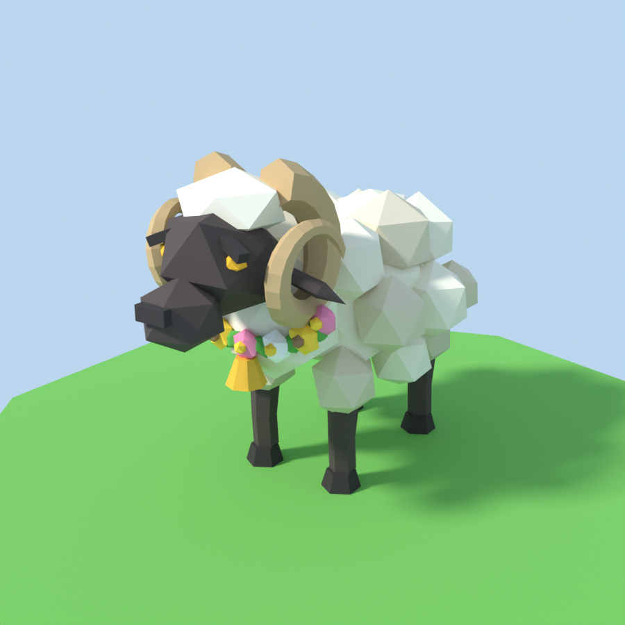
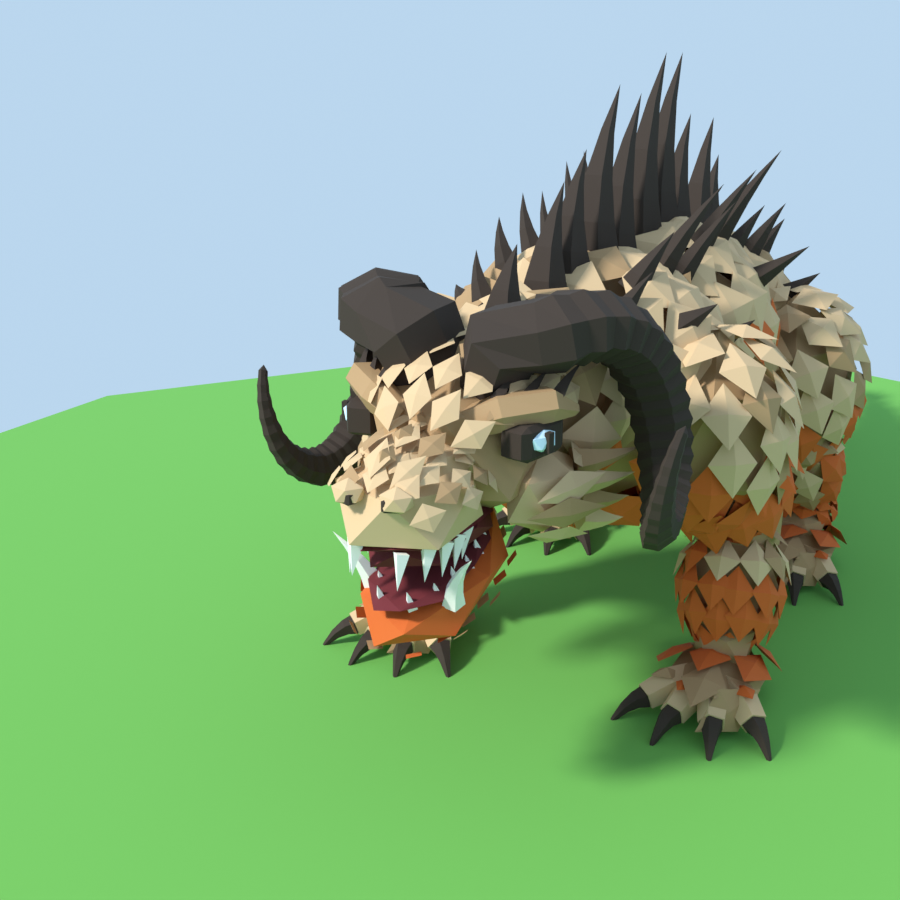
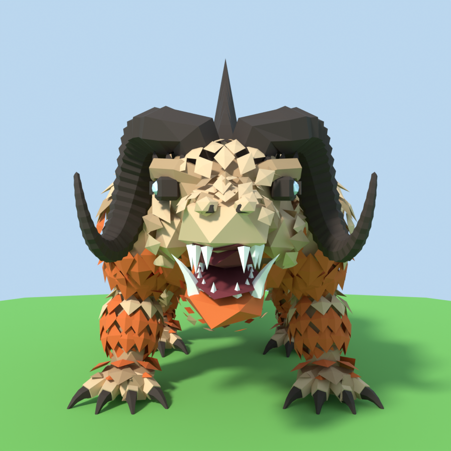
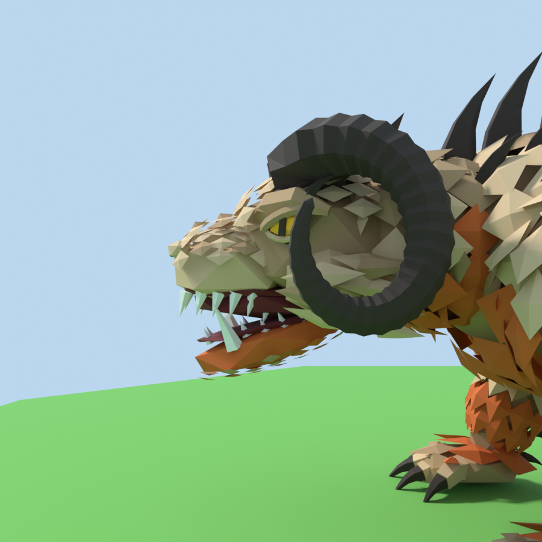
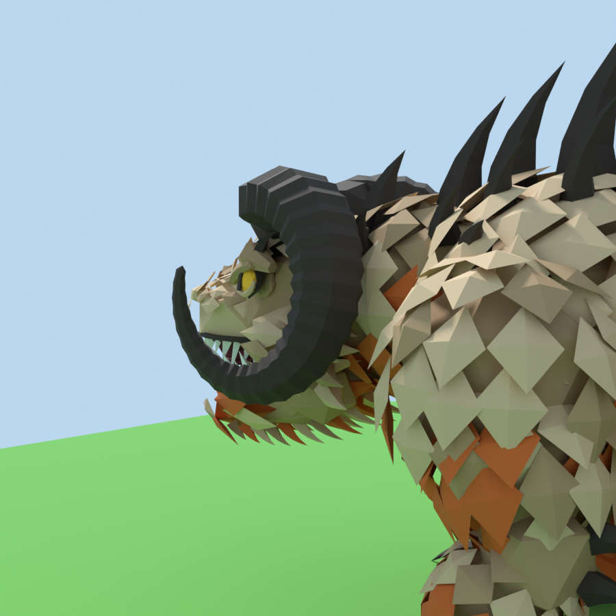
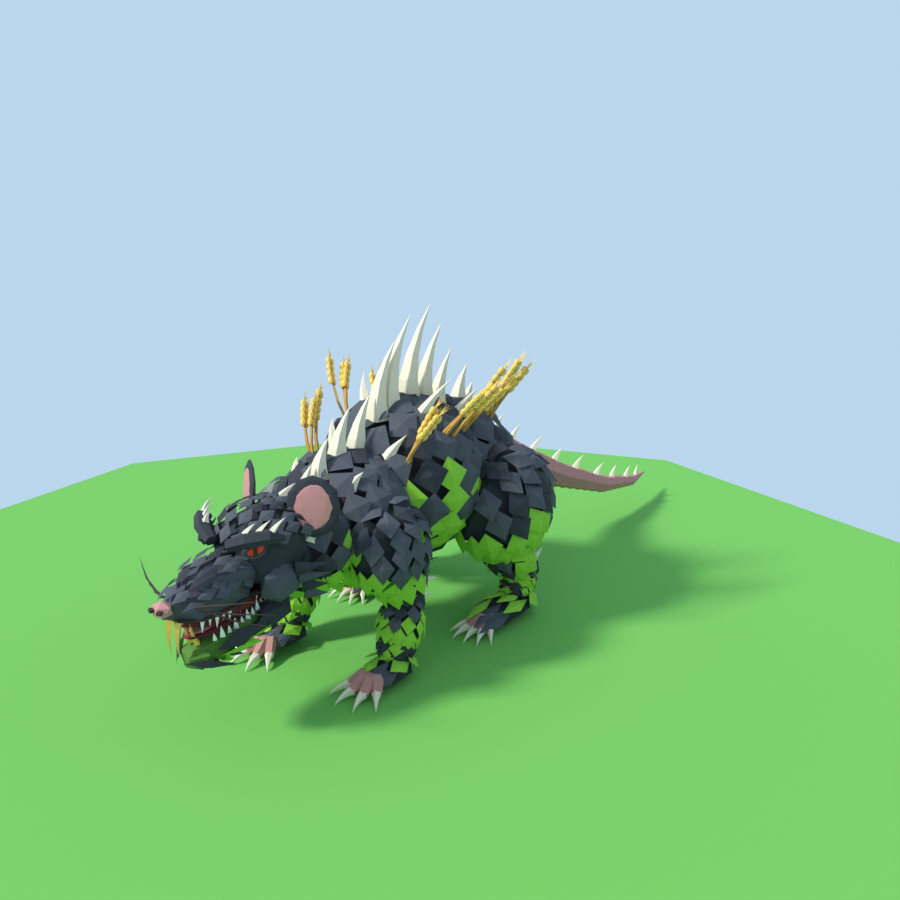
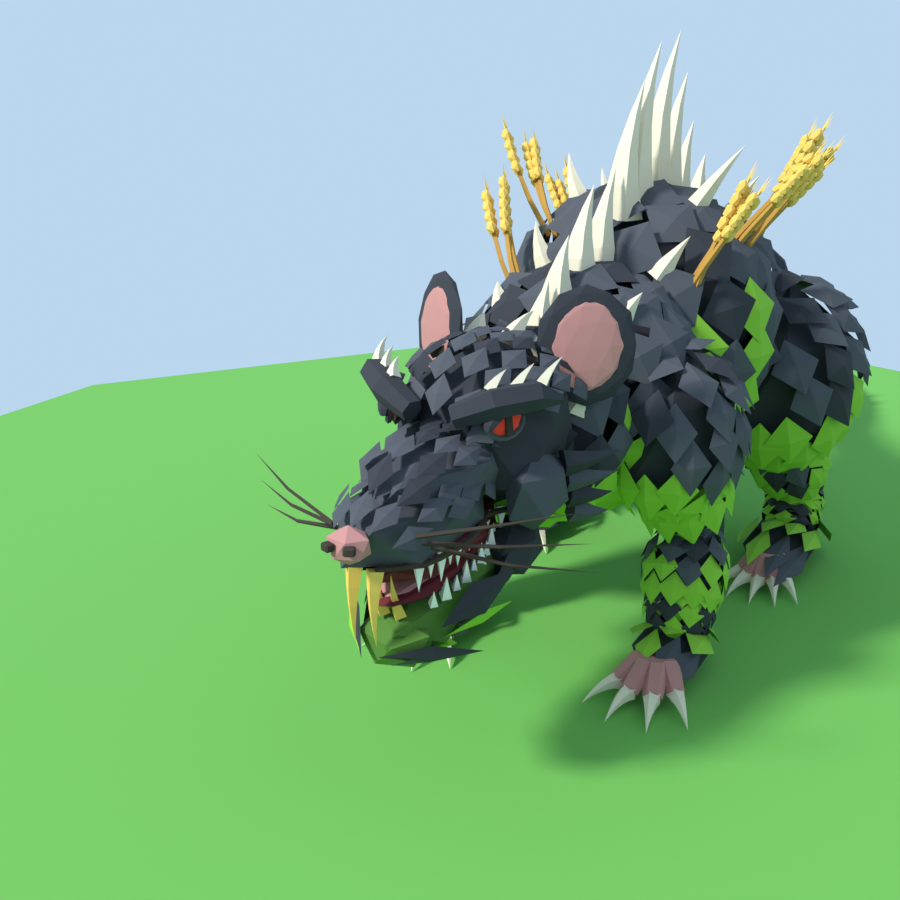
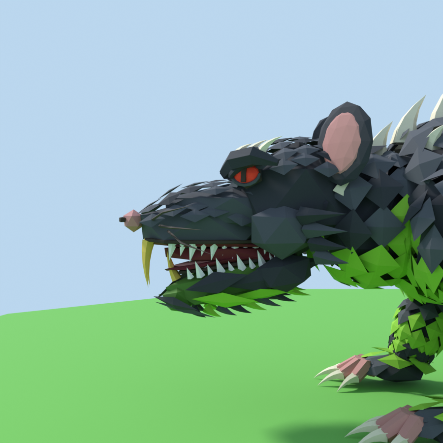
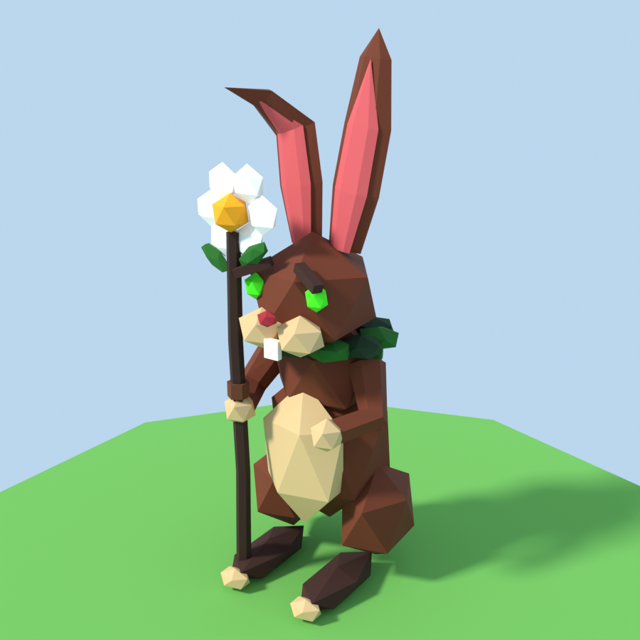

## Conseils d'import dans Roblox

- **Échelle** : 1 unité Blender = 1 stud (un joueur fait ~5 studs). Si la taille ne colle pas, ajuste l'échelle dans l'importeur.
- **Yeux** : les pièces `Oeil_G` / `Oeil_D` sont séparées. Bélier (iris ambre) et Rat (iris rouge) : mets `Material = Neon` pour qu'il brille. Lièvre : yeux noirs brillants (garder `SmoothPlastic`).
- **Animation (Lièvre)** : les pièces sont nommées et séparées (Tete, Oreille_D, Bras_G, Baton…) pour être reliées par des `Motor6D`.
- **Orientation** : les modèles regardent vers l'avant (-Y dans Blender) ; tourne le modèle dans Studio si besoin.

## Animations des gardiens (Bélier, Rat)

Code commun : `lib/animation.py` ; chaque modèle a ses réglages (`ANIM` dans son script) et un petit module
`scripts/animations_<modele>.py`. Squelette de 24 os (Racine, Torse, Tete, Machoire, Paupiere_G/D, Queue1-4, 3 à 4 os par patte + pied). Les pièces sont liées
aux os ; la queue et les pattes se plient en douceur. Les pieds restent posés au sol (cinématique inverse).

| Animation | Durée | Boucle | Aperçu |
|---|---|---|---|
| `Marche` | 1,3 s | oui | pas en diagonale sur place (Bélier ~4,5 studs/s, Rat ~3,9) |
| `Course` | 0,7 s | oui | galop, grandes foulées (Bélier ~11,5 studs/s, Rat ~8,5) |
| `Sommeil` | 3,0 s | oui | couché en sphinx, yeux fermés, queue enroulée, respiration lente |
| `CoupDeCroc` | 1,2 s | non | recul, gueule grande ouverte, attaque, claquement |


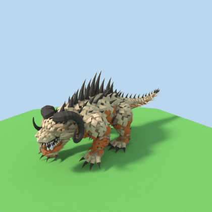
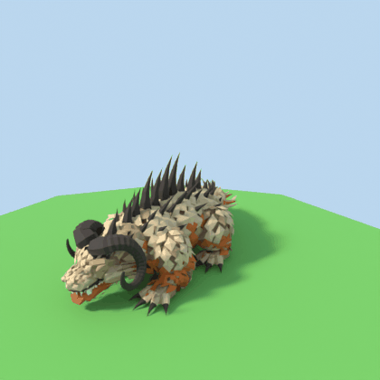
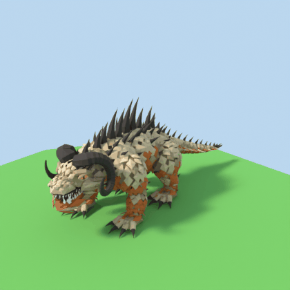
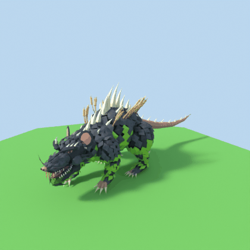
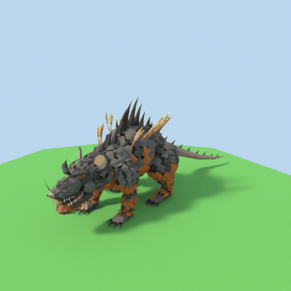

Fichiers (dans `exports/<Nom>/`, ex. `Gardien_Champ_Rat`) :
- `<Nom>_rig.fbx` : modèle + squelette.
- `<Nom>_<Animation>.fbx` : une animation par fichier.
- `<Nom>_anime.glb` : tout en un, pour regarder les animations dans un viewer glTF.

Dans Roblox Studio (pas encore testé de bout en bout) :
1. Importer `<Nom>_rig.fbx` avec l'importeur 3D (le modèle arrive avec ses os).
2. Ouvrir l'**Animation Editor** sur le modèle, puis `…` > *Import* > *From FBX Animation* et choisir
   `<Nom>_Marche.fbx` (recommencer pour chaque animation). Cocher la boucle pour `Marche`, `Course` et `Sommeil`,
   puis publier chaque animation pour obtenir son ID.
3. Mettre `roblox/Gardien_Animations.server.lua` (commun à tous les gardiens) dans le modèle, coller les ID en haut
   du script et régler ses vitesses (valeurs du Bélier et du Rat indiquées en commentaire).
   Le script joue `Marche` quand le gardien bouge puis `Course` au-delà du seuil (à l'arrêt il garde sa pose),
   lance le coup de croc avec `gardien:SetAttribute("Action", "CoupDeCroc")` et le fait dormir avec
   `gardien:SetAttribute("Dort", true)` (`false` pour le réveiller).

Les pièces `Paupiere_G` / `Paupiere_D` sont cachées dans la tête : seule l'animation `Sommeil` les fait sortir.

## Structure

```
.claude/skills/   skill « modele-roblox-lowpoly » (la méthode, pour les prochains modèles)
lib/lowpoly.py   outils communs (formes low poly, palette de couleurs, export, rendu)
lib/animation.py squelette + animations communs (Marche, Course, Sommeil, CoupDeCroc)
scripts/         un script par modèle + un petit module d'animations par modèle + le vérificateur
roblox/          scripts Luau à mettre dans Roblox Studio
exports/         fichiers prêts pour Roblox
previews/        images d'aperçu
```
