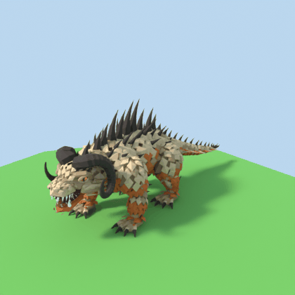

# Animaux V2 — modèles 3D low poly pour Roblox

Modèles générés par scripts Python avec Blender en headless (module `bpy`, sans interface).

## Installation

```bash
pip install -r requirements.txt   # installe bpy (Blender 5.2 en module Python)
```

## Générer un modèle

```bash
python3 scripts/gardien_belier.py              # export + images d'aperçu
python3 scripts/gardien_lievre.py --no-render  # export seulement (plus rapide)
python3 scripts/animations_belier.py           # squelette + animations du Bélier (+ GIF d'aperçu)
```

Sorties :
- `exports/<Nom>/<Nom>.fbx` et `.glb` : à importer dans Roblox Studio (*Avatar > 3D Importer* ou *Import 3D*).
- `exports/<Nom>/<Nom>_palette.png` : la texture des couleurs (déjà intégrée au FBX/GLB).
- `previews/<Nom>_avant.png` / `_arriere.png` : aperçus rendus.

## Steal an Egg — Zone Prairie : les gardiens

| Gardien | Rôle | Taille (studs) | Pièces | Triangles |
|---|---|---|---|---|
| **Bélier Colosse** (`Gardien_Prairie_Belier`) | tank / boss — bête couverte d'écailles (pattes comprises), épines, cornes annelées, gueule à crocs, griffes | ≈ 11 × 33 × 14 (haut) | 10 | ~16 000 (max ~3 700 par pièce) |
| **Grand Lièvre Sentinelle** (`Gardien_Prairie_Lievre`) | vigie, rapide — style « blocs » chibi | ≈ 7 × 6 × 16 (haut) | 10 | ~2200 |


## Conseils d'import dans Roblox

- **Échelle** : 1 unité Blender = 1 stud (un joueur fait ~5 studs). Si la taille ne colle pas, ajuste l'échelle dans l'importeur.
- **Yeux** : les pièces `Oeil_G` / `Oeil_D` sont séparées. Bélier : iris ambre, mets `Material = Neon` pour qu'il brille. Lièvre : yeux noirs brillants (garder `SmoothPlastic`).
- **Animation (Lièvre)** : les pièces sont nommées et séparées (Tete, Oreille_D, Bras_G, Baton…) pour être reliées par des `Motor6D`.
- **Orientation** : les modèles regardent vers l'avant (-Y dans Blender) ; tourne le modèle dans Studio si besoin.

## Animations du Bélier Colosse

Squelette de 22 os (Racine, Torse, Tete, Machoire, Queue1-4, 3 à 4 os par patte + pied). Les pièces sont liées
aux os ; la queue et les pattes se plient en douceur. Les pieds restent posés au sol (cinématique inverse).

| Animation | Durée | Boucle | Aperçu |
|---|---|---|---|
| `Repos` | 2,0 s | oui | respiration, tête qui scrute, queue qui ondule |
| `Marche` | 1,3 s | oui | pas en diagonale sur place (~4,5 studs/s) |
| `Morsure` | 1,2 s | non | recul, gueule grande ouverte, attaque, claquement |
| `Rugissement` | 2,5 s | non | tête levée, gueule ouverte au maximum, tremblement |
| `CoupDeQueue` | 1,4 s | non | le corps pivote, la queue balaie |




Fichiers (dans `exports/Gardien_Prairie_Belier/`) :
- `Gardien_Prairie_Belier_rig.fbx` : modèle + squelette.
- `Gardien_Prairie_Belier_<Animation>.fbx` : une animation par fichier.
- `Gardien_Prairie_Belier_anime.glb` : tout en un, pour regarder les animations dans un viewer glTF.

Dans Roblox Studio (pas encore testé de bout en bout) :
1. Importer `Gardien_Prairie_Belier_rig.fbx` avec l'importeur 3D (le modèle arrive avec ses os).
2. Ouvrir l'**Animation Editor** sur le modèle, puis `…` > *Import* > *From FBX Animation* et choisir
   `Gardien_Prairie_Belier_Marche.fbx` (recommencer pour chaque animation). Cocher la boucle pour `Repos` et `Marche`,
   puis publier chaque animation pour obtenir son ID.
3. Mettre `roblox/GardienBelier_Animations.server.lua` dans le modèle et coller les ID en haut du script.
   Le script joue `Repos`, passe à `Marche` quand le gardien bouge, et lance une attaque avec
   `gardien:SetAttribute("Action", "Morsure")` (ou `"Rugissement"`, `"CoupDeQueue"`).

## Structure

```
lib/lowpoly.py   outils communs (formes low poly, palette de couleurs, export, rendu)
scripts/         un script par modèle (+ animations_belier.py)
roblox/          scripts Luau à mettre dans Roblox Studio
exports/         fichiers prêts pour Roblox
previews/        images d'aperçu
```
